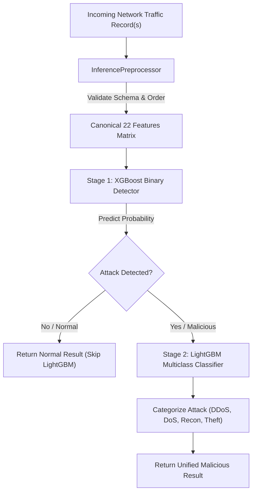

# Cascaded Inference Pipeline for IoT Botnet Detection

This document provides a comprehensive overview of the modular, cascaded inference pipeline designed for Smart Home IoT Botnet Detection.

---

## 1. Overall Architecture

The inference pipeline employs a **two-stage cascaded architecture** to maximize computational efficiency, minimize detection latency, and prevent unnecessary execution of multiclass classification logic for benign network traffic.



### Key Architectural Benefits
- **Zero Target Leakage**: Strips out ground truth labels (`attack`, `category`, `subcategory`) if present in incoming payloads.
- **Compute Optimization**: Benign network traffic (the overwhelming majority in production IoT environments) immediately exits after Stage 1, completely bypassing Stage 2.
- **Batch Vectorization**: When processing batches, Stage 1 evaluates all flows simultaneously, filters only malicious candidates, and routes exclusively those candidates to Stage 2.
- **Loose Coupling & Modularity**: Preprocessing, artifact loading, model prediction, and pipeline orchestration are separated into distinct modules.

---

## 2. Model Responsibilities

| Stage | Model Engine | Training Target | Primary Responsibility | Output Labels |
|---|---|---|---|---|
| **Stage 1** | **XGBoost** (`xgb_binary_pipeline.joblib`) | `attack` (Binary) | High-throughput boundary detection separating benign traffic from threats. | `Normal` (0) vs. `Malicious` (1) |
| **Stage 2** | **LightGBM** (`lightgbm_category.joblib`) | `category` (Multiclass) | Granular threat categorization on confirmed attacks; dynamically derives classes. | `DDoS`, `DoS`, `Reconnaissance`, `Theft` |

---

## 3. Inference Workflow

1. **Ingestion**: Raw network telemetry is accepted as a dictionary, list of dictionaries, pandas Series, or DataFrame.
2. **Preprocessing & Validation (`InferencePreprocessor`)**:
   - Ensures all 22 canonical features are present.
   - Enforces strict canonical column ordering.
   - Converts categorical features (`proto`, `flgs`, `state`) to string representations.
   - Coerces numerical features to float/int, raising validation errors for malformed types.
   - Strips auxiliary or target columns.
3. **Stage 1 Binary Classification (`XGBoostBinaryPredictor`)**:
   - Executes the fitted XGBoost pipeline.
   - Generates binary prediction and confidence score $P(\text{class})$.
4. **Conditional Execution**:
   - If predicted as **Normal**: LightGBM prediction is skipped entirely.
   - If predicted as **Malicious**: The flow is forwarded to Stage 2.
5. **Stage 2 Multiclass Classification (`LightGBMCategoryPredictor`)**:
   - Executes the fitted LightGBM pipeline on malicious flows.
   - Predicts attack category and extracts category confidence.
6. **Result Formatting**: Returns standardized structured dictionary/list.

---

## 4. Input Requirements

The inference engine expects the **canonical 22 features** defined in `config/settings.py`:

| Category | Features |
|---|---|
| **Categoricals (3)** | `proto`, `flgs`, `state` |
| **Flow Ports (2)** | `sport`, `dport` |
| **Packet Counts (3)** | `pkts`, `spkts`, `dpkts` |
| **Duration & IAT Stats (4)** | `dur`, `mean`, `stddev`, `min` |
| **Flow Rate & Window Metrics (7)** | `rate`, `TnBPSrcIP`, `TnBPDstIP`, `TnP_PSrcIP`, `TnP_PDstIP`, `TnP_PerProto`, `TnP_Per_Dport` |
| **Connection Density Metrics (3)** | `N_IN_Conn_P_DstIP`, `N_IN_Conn_P_SrcIP`, `Pkts_P_State_P_Protocol_P_SrcIP` |

### Input Formats Supported
- Single `dict`
- `list` of `dict`
- `pandas.Series`
- `pandas.DataFrame`

---

## 5. Output Structure

### Normal Detection Output
```json
{
    "status": "success",
    "binary_prediction": "Normal",
    "attack_detected": false,
    "attack_category": null,
    "binary_confidence": 0.9852,
    "category_confidence": null
}
```

### Malicious Detection Output
```json
{
    "status": "success",
    "binary_prediction": "Malicious",
    "attack_detected": true,
    "attack_category": "DDoS",
    "binary_confidence": 0.9998,
    "category_confidence": 0.9645
}
```

---

## 6. How to Load and Execute the Pipeline

### Python API Example

```python
from src.inference import CascadedInferencePipeline

# 1. Initialize pipeline with pre-trained models from models/
pipeline = CascadedInferencePipeline.from_loader()

# 2. Inspect dynamically learned attack categories
print("Supported Categories:", pipeline.get_supported_categories())
# Output: ['DDoS', 'DoS', 'Normal', 'Reconnaissance', 'Theft']

# 3. Single record inference
sample_flow = {
    "proto": "udp",
    "flgs": "e",
    "state": "INT",
    "sport": 54321,
    "dport": 80,
    "pkts": 50,
    "spkts": 25,
    "dpkts": 25,
    "dur": 0.5,
    "mean": 0.02,
    "stddev": 0.005,
    "min": 0.001,
    "rate": 100.0,
    "TnBPSrcIP": 5000,
    "TnBPDstIP": 5000,
    "TnP_PSrcIP": 50,
    "TnP_PDstIP": 50,
    "TnP_PerProto": 50,
    "TnP_Per_Dport": 50,
    "N_IN_Conn_P_DstIP": 10,
    "N_IN_Conn_P_SrcIP": 10,
    "Pkts_P_State_P_Protocol_P_SrcIP": 50,
}

result = pipeline.predict_single(sample_flow)
print(result)

# 4. Batch inference
batch_results = pipeline.predict_batch([sample_flow, sample_flow])
```

---

## 7. How to Run Tests

Execute the inference unit test suite:

```bash
# Run unit and integration tests for inference package
python -m unittest discover tests/inference/

# Run the complete project test suite to verify no regressions
python -m unittest discover tests/
```

---

## 8. Assumptions and Limitations

1. **Feature Completeness**: All 22 canonical features must be provided. If missing, `InferenceValidationError` is raised.
2. **Dynamic Categories**: Attack categories are not hardcoded; they reflect the labels of the trained Stage 2 LightGBM model.
3. **Threshold Calibration**: Binary classification uses default 0.5 probability thresholds. Operating points can be adjusted if SecOps policies require prioritizing zero false negatives or zero false positives.
4. **Model Artifact Availability**: The pipeline assumes model binaries (`xgb_binary_pipeline.joblib` and `lightgbm_category.joblib`) reside in `models/` or are supplied via custom paths to `ModelLoader`.
