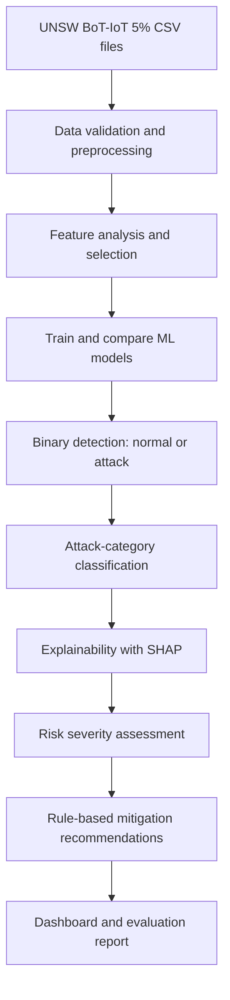
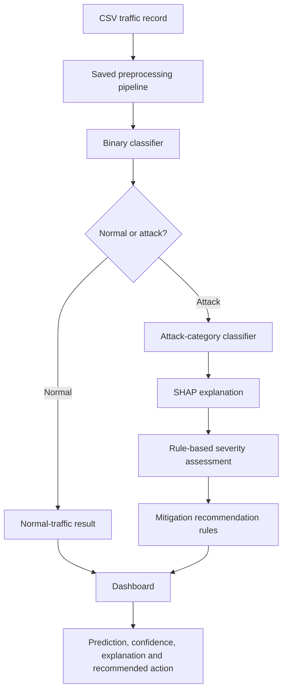

from pathlib import Path

content = r"""# Machine Learning-Based IoT Botnet Detection System
## Project Plan and Implementation Roadmap

**Project type:** Final-Year Computer Engineering Project  
**Target completion date:** 27 November 2026  
**Team size:** 4 members  
**Primary dataset:** UNSW BoT-IoT 5% CSV subset

---

## 1. Project Overview

IoT devices such as cameras, routers, sensors and smart appliances can be compromised and used as part of botnets. These botnets may perform attacks such as Denial of Service (DoS), Distributed Denial of Service (DDoS), reconnaissance and other malicious activities.

This project will develop a machine-learning-based prototype that analyses labelled network-traffic records from the **UNSW BoT-IoT 5% dataset**. It will detect normal versus malicious traffic, classify supported attack categories, explain predictions, estimate risk severity and recommend defensive actions through a dashboard.

The initial implementation will focus on **offline dataset-based detection and evaluation**. Live network monitoring and automatic blocking are future extensions unless they are explicitly implemented and tested.

### Proposed system at a glance



---

## 2. Objectives

1. Prepare and analyse the BoT-IoT dataset for reliable model training and evaluation.
2. Build a binary classifier to distinguish normal traffic from malicious traffic.
3. Build an attack-classification model for the categories supported by the usable dataset labels.
4. Compare multiple machine-learning algorithms using appropriate evaluation metrics.
5. Use SHAP or a comparable explainability method to show which features influenced a prediction.
6. Create a transparent, rule-based severity score and map attack predictions to defensive recommendations.
7. Build a dashboard that presents predictions, metrics, explanations and recommended actions.
8. Document the experiments, limitations and opportunities for future work.

### Success criteria

- Reproducible preprocessing and train/test split.
- Evaluation with precision, recall, F1-score, confusion matrix and false-positive rate—not accuracy alone.
- A working end-to-end demonstration from input record to dashboard result.
- Clear documentation of dataset limitations, model performance and any unimplemented future features.

---

## 3. What We Will Build

### Core components

| Component | Purpose |
|---|---|
| Dataset preparation | Validate files, inspect labels, handle invalid values and prepare model-ready features. |
| Binary detection model | Predict whether traffic is normal or malicious. |
| Attack classifier | Predict an attack category for traffic flagged as malicious, where labels and sample counts support it. |
| Model evaluation | Compare candidate models using the same evaluation protocol. |
| Explainability | Use SHAP to display features contributing to a prediction. |
| Severity and recommendation engine | Apply documented rules to assign a risk level and suggest defensive actions. |
| Dashboard | Display traffic results, predictions, explanations, metrics and recommendations. |
| Final report and demo | Record the methodology, results, limitations and a reproducible demonstration. |

### Important design decisions

- Start with **Logistic Regression, Decision Tree and Random Forest** as baseline models. Add XGBoost or another model if time and environment permit.
- Use the same train/test split and evaluation protocol when comparing models.
- Check for data leakage before training. Identifiers or fields that reveal the label or collection process should not be allowed to inflate results.
- Handle class imbalance carefully. Compare class weighting or sampling only on training data.
- Fit preprocessing transformations on the training split only.
- Make the severity score a transparent rule-based component, not a claim that the model has learned a clinically or operationally validated risk score.
- Keep mitigation recommendations advisory. The prototype will not automatically block devices or change network settings.

---

## 4. Dataset and Data Strategy

**Dataset:** UNSW BoT-IoT 5% subset, using the available CSV files.

The dataset contains labelled IoT network-traffic records representing normal and malicious activity. Available labels may support binary detection and finer-grained attack classification.

### Data preparation steps

1. Load the CSV files and confirm row counts, column names and label distributions.
2. Check missing values, invalid values, duplicate rows and data types.
3. Inspect `attack`, `category` and `subcategory` labels where present.
4. Exclude identifiers and leakage-prone fields after reviewing their meaning.
5. Separate features from target labels.
6. Create a stratified train/validation/test split where feasible.
7. Apply encoding, scaling and any balancing technique using training data only.
8. Save the preprocessing configuration and split details so results can be reproduced.

**Dataset caution:** BoT-IoT is highly imbalanced. Report class distributions and per-class metrics. If the team uses a smaller sample for faster experimentation, document the sampling method and do not describe the sample as the full dataset.

---

## 5. Proposed Technical Stack

| Area | Proposed tools | Use |
|---|---|---|
| Programming | Python | Data processing, model training and evaluation |
| Data analysis | pandas, NumPy | Load, inspect and transform CSV data |
| Visualisation | Matplotlib, Seaborn | Class distributions, confusion matrices and result plots |
| Machine learning | scikit-learn | Baseline models, preprocessing pipelines and metrics |
| Optional model | XGBoost | Additional boosted-tree comparison if feasible |
| Explainability | SHAP | Feature-contribution explanations |
| Dashboard | Streamlit | Interactive prototype for predictions and visualisations |
| Development | Jupyter Notebook / VS Code | Experimentation and implementation |
| Collaboration | Git and GitHub | Version control, issues, code review and integration |
| Documentation | Markdown and presentation software | Project plan, experiment records and final presentation |

**Implementation principle:** Keep the first version simple and reproducible. Avoid adding a database, cloud deployment, LLM integration or live packet capture unless the core detection pipeline is working and time remains.

---

## 6. System Architecture



The dashboard will display the output of the trained pipeline. The classifier produces the prediction; SHAP explains feature contributions; separate documented rules assign severity and map the result to a recommendation. These components have different roles and should not be described as though one model performs all of them.

---

## 7. Evaluation Plan

### Metrics

- **Precision:** How many predicted attacks are actually attacks.
- **Recall:** How many actual attacks the model detects.
- **F1-score:** Balance between precision and recall.
- **Confusion matrix:** Counts of correct and incorrect predictions by class.
- **False-positive rate:** How often normal traffic is incorrectly flagged.
- **Accuracy:** Overall proportion of correct predictions; interpreted alongside the other metrics.
- **PR-AUC:** Useful when evaluating highly imbalanced classes, where applicable.

### Experimental procedure

1. Establish a reproducible baseline.
2. Train candidate models on the same training split.
3. Tune parameters using training/validation data only.
4. Select a model based on the chosen metrics and project requirements.
5. Evaluate the selected model once on the held-out test set.
6. Evaluate attack-category performance separately from binary detection.
7. Record runtime and practical limitations where feasible.
8. Save model settings, random seeds, metrics and plots.

Do not promise a target accuracy before experiments are completed. Results reported by other papers are not guaranteed to transfer to this dataset split or implementation.

---

## 8. Work Distribution for Four Members

The roles below give each member a primary responsibility while requiring shared integration and review.

| Member | Primary ownership | Key deliverables |
|---|---|---|
| **Member 1 — Data and Preprocessing** | Dataset inspection, cleaning, labels, leakage checks, splits and preprocessing pipeline | Data-quality report, reusable preprocessing code and documented data splits |
| **Member 2 — ML Models and Evaluation** | Baseline models, training, tuning and comparative evaluation | Trained models, metrics table, confusion matrices and model-selection rationale |
| **Member 3 — Explainability and Decision Support** | SHAP integration, transparent severity rules and mitigation mapping | Explanation component, severity rules and recommendation catalogue |
| **Member 4 — Dashboard and Integration** | Streamlit interface, loading saved pipeline/models and connecting outputs | Working dashboard, integration tests and demo flow |

### Shared responsibilities

- **All members:** Review the literature, agree on evaluation rules, test the integrated system and contribute to the final report and presentation.
- Member 1 and Member 2 should coordinate on label definitions, data splits and leakage prevention.
- Member 2 and Member 3 should coordinate so explanations correspond to the selected model and its actual features.
- Member 3 and Member 4 should agree on a stable output format for predictions, explanations and recommendations.
- Member 4 should integrate components only through agreed interfaces; each component owner remains responsible for testing their code.
- Each member should document setup instructions and commit work through GitHub.

### Suggested integration contract

A prediction result should use a consistent structure, for example:

```json
{
  "prediction": "attack",
  "attack_category": "DDoS",
  "confidence": 0.95,
  "severity": "High",
  "top_features": ["feature_1", "feature_2"],
  "recommendation": "Review the source and destination traffic; investigate and isolate the affected device if confirmed."
}
```

This is an illustrative format, not a real prediction. The actual attack labels, confidence availability, feature names and recommendation wording must come from the implemented pipeline and documented rules.

---

## 9. Implementation Roadmap

**Deadline: 27 November 2026**

The plan below is intentionally compact. Complete the core detection pipeline before optional enhancements.

| Dates | Phase | Main activities | Deliverable |
|---|---|---|---|
| **13–18 Oct** | Scope and setup | Finalise requirements, confirm dataset files, set up GitHub repository and Python environment | Agreed scope, repository and environment |
| **19–25 Oct** | Data understanding | Inspect labels, class imbalance, data quality and potential leakage; define splits | Dataset analysis and preprocessing plan |
| **26 Oct–1 Nov** | Preprocessing and baselines | Build reproducible preprocessing; train first baseline models | Working baseline and initial metrics |
| **2–8 Nov** | Model comparison | Compare models, tune using validation data and assess per-class performance | Selected model and evaluation results |
| **9–13 Nov** | Explainability and recommendations | Add SHAP, define severity rules and map attacks to advisory actions | Tested analysis and recommendation modules |
| **14–18 Nov** | Dashboard and integration | Connect saved pipeline, predictions, explanations and recommendations | End-to-end prototype |
| **19–22 Nov** | Testing and improvement | Test normal and attack cases, fix bugs, verify reproducibility and refine interface | Stable demonstration version |
| **23–25 Nov** | Documentation | Complete methodology, experiments, limitations and results | Draft report and supporting figures |
| **26 Nov** | Final validation | Run a clean end-to-end demo; verify files and presentation | Final tested build |
| **27 Nov** | Submission milestone | Freeze code, finalise report and presentation, prepare demo | Submission-ready project package |

**Schedule rule:** If the project falls behind, prioritise dataset integrity, reliable binary detection, evaluation and a working dashboard. Treat advanced attack classification, extensive tuning and optional integrations as secondary until the end-to-end pipeline works.

---

## 10. Testing and Risk Management

### Minimum test checklist

- [ ] All CSV files load successfully and label counts are recorded.
- [ ] Training and test data are separated before fitting transformations or balancing data.
- [ ] The pipeline produces predictions for both normal and attack examples.
- [ ] Binary and attack-category metrics are reported separately.
- [ ] The dashboard displays prediction outputs without crashing.
- [ ] SHAP explanations refer to the correct model features.
- [ ] Every severity level and recommendation rule has a documented basis.
- [ ] Missing, malformed or unsupported input is handled safely.
- [ ] Results can be reproduced from documented setup steps.

### Main risks and responses

| Risk | Response |
|---|---|
| Severe class imbalance | Report per-class metrics; evaluate training-only class weighting or sampling. |
| Data leakage | Review features and fit all transformations on training data only. |
| Large CSV files or limited RAM | Load only required columns, process in chunks or use a documented sample for early experiments. |
| Model results look unrealistically high | Check duplicates, split strategy, leakage and test-set independence. |
| Integration delays | Define interfaces early and integrate small working components continuously. |
| Time pressure | Deliver a reliable core prototype first; leave live monitoring and automated response as future work. |

---

## 11. Expected Deliverables

By 27 November 2026, the target project package is:

1. A documented BoT-IoT data-preparation pipeline.
2. Trained binary detection and, if feasible, attack-category models.
3. A comparative evaluation with appropriate metrics and plots.
4. SHAP-based explanations for model predictions.
5. A documented severity-scoring and mitigation-recommendation component.
6. An integrated Streamlit dashboard.
7. Source code, setup instructions and experiment records in GitHub.
8. Final report, presentation and a repeatable demonstration.

If a component cannot be completed or validated, document it as a limitation or future extension rather than presenting it as a finished feature.

---

## 12. Scope Boundaries

**Included in the initial project**

- Offline analysis of BoT-IoT CSV records.
- Binary attack detection.
- Attack-category classification where supported by data and time.
- Model comparison and evaluation.
- SHAP-based explanation.
- Rule-based severity assessment and mitigation recommendations.
- Dashboard and reproducible demonstration.

**Not part of the guaranteed initial scope**

- Live capture from production IoT networks.
- Automatic blocking or changing firewall/router rules.
- A guaranteed detection-latency claim.
- Cloud-scale deployment or a production security operations platform.
- An LLM-based response system.

These can be explored later if the core prototype is complete and there is sufficient time.

---

## 13. Final Project Summary

The project will build an explainable IoT botnet detection prototype using machine learning and the UNSW BoT-IoT dataset. It will focus on reliable preprocessing, fair model evaluation, attack classification, feature-level explanations and practical mitigation recommendations. A dashboard will connect these components into a demonstrable workflow.

The team will work in parallel across data preparation, model development, explainability and dashboard integration, with shared testing and documentation. The primary goal is a **reproducible, evaluated end-to-end prototype by 27 November 2026**, with advanced real-time features treated as extensions rather than assumptions.

"""
path = Path("/mnt/data/iot_botnet_project_plan.md")
path.write_text(content, encoding="utf-8")
print(f"Created: {path}")
